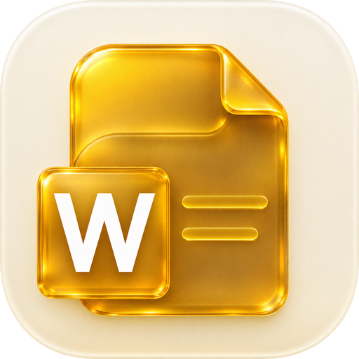

  

# Word AW

O **Word AW** é um editor de documentos para uso interno na Alimentos Wilson. Caio Rodrigues criou esta edição para preparar documentos como comunicados, procedimentos e relatórios.

O aplicativo abre e salva arquivos `.docx`, oferece interface em português e tem temas claro e escuro. No menu **Arquivo** estão os comandos para criar, abrir, salvar, imprimir e exportar documentos. Em **Conta**, cada pessoa pode personalizar seu perfil local.

## Por que Rust?

A interface, a edição de documentos e a leitura de arquivos são escritas em **Rust**. O compilador verifica o uso da memória em código seguro, e o projeto separa a interface do processamento dos documentos para facilitar a manutenção.

## Licenças e créditos

Os termos e as atribuições estão em [NOTICE](NOTICE), [LICENSE-MIT](LICENSE-MIT), [LICENSE-APACHE](LICENSE-APACHE) e [ATTRIBUTION.md](ATTRIBUTION.md).
